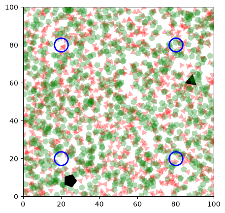
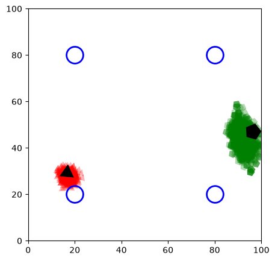

# Particle Filtering for Robot Localization

A Python project comparing localization with four landmark measurements against localization with only a distance measurement to another uncertain robot.

I implemented particle weighting, normalization, and resampling for Pacman and a ghost using a course-provided simulation framework. The project uses **1,000 particles per robot**, **10 movement steps per run**, and **10 recorded experimental runs**.

## What I implemented

- Pacman weighting from four noisy landmark-distance measurements.
- Ghost weighting using one randomly selected resampled Pacman particle per ghost particle, without reading Pacman's true coordinates in the filter update.
- Weight normalization, including an equal-weight fallback when the total likelihood is zero.
- Multinomial resampling through cumulative probabilities and independent random draws.
- Diagnostics for maximum normalized weights and the number of distinct selected particle objects.
- Analysis of final errors across 10 runs: mean, population standard deviation, minimum, and maximum.

## Results

The error metric is the average distance from the particles to the true robot position, calculated by the provided evaluation function with wrap-around distances for the cyclic environment. It is not a percentage accuracy or the error of a single point estimate. Lower is better.

| Final Turn #10 error | Pacman | Ghost |
| --- | ---: | ---: |
| Mean | 2.76 | 13.00 |
| Population standard deviation | 0.65 | 11.69 |
| Minimum | 2.10 | 5.64 |
| Maximum | 4.21 | 37.61 |

Statistics use the final errors after resampling from the following recorded runs, rounded to two decimal places before analysis.

| Run | Pacman | Ghost |
| --- | ---: | ---: |
| 1 | 3.03 | 7.40 |
| 2 | 4.21 | 6.69 |
| 3 | 2.27 | 34.91 |
| 4 | 2.10 | 5.99 |
| 5 | 2.81 | 37.61 |
| 6 | 2.26 | 5.64 |
| 7 | 2.32 | 7.43 |
| 8 | 3.63 | 8.50 |
| 9 | 2.53 | 9.02 |
| 10 | 2.44 | 6.78 |

Pacman had lower and more consistent final errors in these experiments. The ghost performed reasonably in many runs but had substantially larger errors in runs 3 and 5. Those runs also retained fewer distinct ghost particle objects; this is an observation, not proof that diversity loss caused the errors.

## Example visualization

Red triangles represent Pacman particles; green pentagons represent ghost particles. Black markers are the actual robots, and blue circles are landmarks. The images below are extracted from the saved notebook run; they are not averages across runs.

### Initial particle distributions



### After the final resampling step



The environment wraps at its edges. A cloud near one edge can be near particles on the opposite edge under the evaluation metric.

## What I learned

A concentrated particle distribution does not necessarily mean an accurate estimate. The ghost has fewer direct position constraints: one distance measurement alone cannot specify a unique location. Movement and later measurements can narrow the possibilities, while uncertainty in Pacman's estimated position affects the ghost's update. Resampling can occasionally increase the true localization error even when it follows the intended probabilities.

## Files

- `particle_filtering.ipynb`: simulation, implementation, saved visualizations, and discussion.
- `experiment_analysis.ipynb`: recorded final errors and statistical calculations.
- `figures/`: selected figures extracted from the saved simulation.
- `requirements.txt`: packages for running the notebooks in a Python notebook environment.

## Running the notebooks

Use a Python environment with the packages in `requirements.txt`:

```bash
python -m pip install -r requirements.txt
```

Open the notebooks in VS Code or another Jupyter-compatible editor and select that environment as the kernel. Run `particle_filtering.ipynb` from the beginning so the robot states and particles are initialized before the simulation. Run `experiment_analysis.ipynb` to recalculate the statistics from the recorded data.

The simulation is stochastic. Random seeds were not recorded for the original 10 runs, so those exact trajectories cannot be reconstructed from a seed list. A new simulation run produces new results and does not automatically update the recorded error lists. The analysis notebook reproduces the reported aggregate statistics from those lists.

## Limitations and possible improvements

The ghost update samples only one Pacman hypothesis per ghost particle. Averaging likelihoods over multiple Pacman hypotheses could reduce the sampling noise in that approximation at additional computational cost. This alternative was considered, not implemented or evaluated here. The 10 runs are a small experimental sample, not evidence of performance in all conditions. The reported standard deviations describe variation between runs, not the uncertainty of a single particle distribution.

## Attribution and publication

The course starter supplied the robot classes, motion and sensing models, visualization, evaluation function, initialization, and simulation scaffold. My contributions are the student filtering implementation, diagnostics, experimental work, and analysis described above. The original comments remain in the notebook.

This portfolio copy excludes the assignment prompt, grading rubric, and instructor reference images. It still contains instructor-provided code. Keep the repository private unless the course/instructor permits public sharing. No license for instructor-provided material is asserted by this repository.
